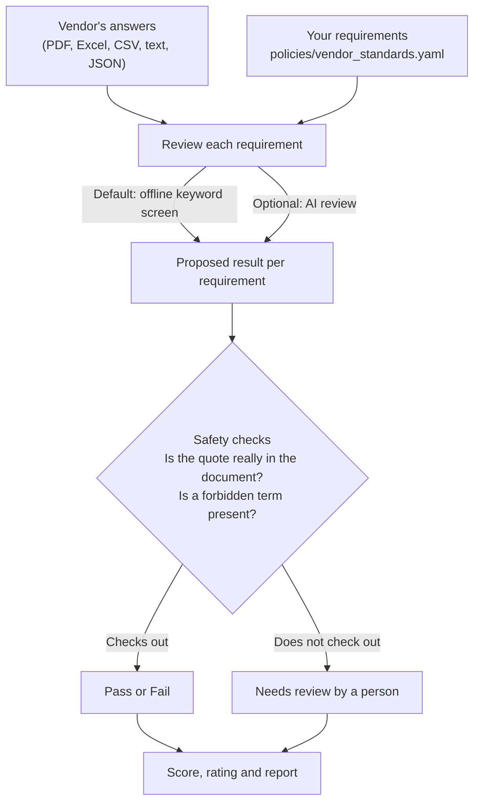

# AI TPRM Risk Engine (Context-Aware)

### Dynamic Vendor Risk Assessment & Compliance Auditing


---

## Executive summary

**The problem.** Before a company buys from a vendor, someone has to read the vendor's security answers and decide whether they meet the company's requirements. That reading is slow, repetitive, and inconsistent from one reviewer to the next.

**What this tool does.** It reads a vendor's security answers, compares them with your written requirements, and produces a one-page report: a score, a rating, what failed, what is still unanswered, and what to ask the vendor next. Every conclusion quotes the vendor's own words so a reviewer can check it in seconds.

**What it does not do.** It does not approve or reject vendors. It does not verify that a vendor does what it claims. It prepares the review; a qualified person makes the decision.

**Why it is safe to try.**

| Concern | How it is handled |
| :--- | :--- |
| Vendor documents are confidential | By default everything runs on your computer and nothing is sent anywhere. AI review is a separate, explicit choice. |
| AI can make things up | Every AI pass or fail must quote the vendor's document, and the code checks the quote is really there. If it is not, the item goes to a person. |
| A vendor could hide instructions to the AI in a document | Such text is flagged in the report, and it cannot produce a pass without a real quote. |
| Results could leak into chat or tickets | Slack and Jira are used only when you ask, and they receive the summary, not quotes from the vendor's document. |
| Unclear answers get waved through | Anything vague, partial or missing is marked "Needs review" and earns no points. |
| Results need to stand up later | Each report records the date, the tool version, and a fingerprint of the exact vendor file and policy used. |

**What it costs to run.** The default mode is free. AI review uses your own Anthropic or OpenAI account and is billed by that provider.

---

## How it works



Each requirement ends up as one of three results:

| Result | Meaning |
| :--- | :--- |
| **Pass** | The vendor's document states the requirement is met, and the report quotes where. |
| **Fail** | The vendor's document states something that breaks the requirement, and the report quotes where. |
| **Needs review** | The document is silent, vague, or qualified ("planned", "except contractors"). A person has to follow up. |

---

## Quick start (about 5 minutes)

You need **Python 3.10 or newer**. To check, open a terminal (on Windows: PowerShell) and run `python --version`. If the number is lower than 3.10 or the command is not found, install Python from [python.org/downloads](https://www.python.org/downloads/). On Windows, tick "Add python.exe to PATH" in the installer.

### 1. Download the tool

```bash
git clone https://github.com/codyjkeller/ai-tprm-analyzer.git
cd ai-tprm-analyzer
```

No git? On the GitHub page choose **Code → Download ZIP**, unzip it, and open a terminal in that folder.

### 2. Install it in its own sandbox

A "virtual environment" keeps this tool's files separate from the rest of your computer.

**macOS / Linux**
```bash
python3 -m venv .venv
source .venv/bin/activate
pip install -r requirements.txt
```

**Windows (PowerShell)**
```powershell
python -m venv .venv
.venv\Scripts\Activate.ps1
pip install -r requirements.txt
```

Your prompt now starts with `(.venv)`. Run the activate line again whenever you open a new terminal.

### 3. Run the example

```bash
python -m tprm analyze examples/weak_vendor.txt
```

You should see:

```text
Mode: offline keyword screen. Nothing leaves this computer.
                       Vendor: Example Legacy Hosting Co.

  Result         Control                         Why
 ──────────────────────────────────────────────────────────────────────────────
  Fail           SC-13 Encryption in Transit     The document mentions the
                                                 forbidden term 'DES'.
  Needs review   AC-2 Access Control             The document does not address
                                                 this control.
  Needs review   IA-2(1), IA-2(2)                The document does not address
                 Identification &                this control.
                 Authentication
  Needs review   SC-28 Encryption at Rest        The document does not address
                                                 this control.
  Pass           IA-2(1) MFA for Privileged      Keyword match on
                 Accounts                        'Multi-factor
                                                 authentication'. A keyword
                                                 match does not prove the
                                                 control covers everyone in
                                                 scope.
  Pass           IA-2(2) MFA for                 Keyword match on
                 Non-Privileged Accounts         'Multi-factor
                                                 authentication'. A keyword
                                                 match does not prove the
                                                 control covers everyone in
                                                 scope.

╭─────────────────────────────────── Result ───────────────────────────────────╮
│ 🚫 HIGH RISK (Reject)                                                        │
│ Score: 30 out of 100                                                         │
│ 1 control(s) failed and 3 need a person to review. If every item under       │
│ review is confirmed, the score would be 85.                                  │
╰──────────────────────────────────────────────────────────────────────────────╯
```

Three report files appear in the `reports/` folder:

| File | For |
| :--- | :--- |
| `.md` | People. Opens in any text editor; GitHub, VS Code and most wikis show it formatted. Starts with an executive summary. |
| `.csv` | Spreadsheets and GRC tools. One row per requirement. |
| `.json` | Other systems and long-term records. Contains everything, including the audit trail. |

### 4. Run it on a real vendor

Save the vendor's answers anywhere on your computer and point the tool at the file:

```bash
python -m tprm analyze "path/to/vendor answers.pdf" --vendor-name "Acme Cloud"
```

| File type | What works best |
| :--- | :--- |
| `.xlsx`, `.csv` | Questionnaires with a "Question" column and an "Answer" or "Response" column. |
| `.pdf` | Text PDFs such as policies or SOC 2 reports. Scanned images need OCR first. |
| `.txt`, `.md` | Any written security overview. |
| `.json` | See `examples/vendor_response.json` for the layout. |

`reports/` is ignored by git, so assessments are not committed by accident. Keep real vendor files outside this folder, or in `vendor_files/`, which is also ignored.

---

## The two review modes

| | Offline keyword screen (default) | AI review (optional) |
| :--- | :--- | :--- |
| How it decides | Looks for the exact terms listed in your policy. | A language model reads the document against each requirement. |
| Data leaving your computer | None. | The vendor document's text goes to Anthropic or OpenAI. |
| Cost | Free. | Billed to your provider account. |
| Strength | Fast, repeatable, no approvals needed. | Understands meaning, scope and wording. |
| Weakness | Cannot understand meaning. | Can differ between runs; needs provider approval in most companies. |
| Best rating it can give | "Keyword screen passed (confirm before approving)". | Whatever your policy's thresholds allow. |

**Why the keyword screen's passes need confirming.** Look at the example output above. The vendor wrote "Employees use multi-factor authentication, contractors use passwords". That earned a Pass on both MFA requirements because the words "multi-factor authentication" are present. A person, or the AI review, sees that contractors are not covered. The keyword screen is a first filter, not a verdict, which is why it can never award the top rating.

### Turning on AI review

Check your company's AI usage policy first: the vendor's document will be sent to the provider you choose.

1. Copy `.env.example` to a new file named `.env`.
2. Open `.env` and paste your key after `ANTHROPIC_API_KEY=` (or `OPENAI_API_KEY=`). The `.env` file is ignored by git.
3. Run:

```bash
python -m tprm analyze examples/weak_vendor.txt --provider anthropic
```

For OpenAI, also name the model your account uses:

```bash
python -m tprm analyze examples/weak_vendor.txt --provider openai --model <model-name>
```

Having a key in `.env` does not switch AI review on. It is used only when you pass `--provider` or set `TPRM_PROVIDER`.

### Using the AI your company already has

| `--provider` | Use it when | Settings in `.env` |
| :--- | :--- | :--- |
| `anthropic` | You have an Anthropic account. | `ANTHROPIC_API_KEY` |
| `openai` | You have an OpenAI account. | `OPENAI_API_KEY`, and `--model` |
| `azure` | Your company uses Azure OpenAI. | `AZURE_OPENAI_API_KEY`, `AZURE_OPENAI_ENDPOINT`, `OPENAI_API_VERSION`, and `--model` set to your deployment name |
| `openai-compatible` | Your company has an internal AI gateway, or runs a model on its own network. | `TPRM_BASE_URL`, optionally `TPRM_API_KEY`, and `--model` |

With `openai-compatible` pointed at a model on your own network, AI review runs without the vendor's document leaving your organization. The safety checks are the same whichever engine you choose.

---

## Connections (optional)

Each connection is off until you ask for it on the command line. The tool has no login of its own: it runs as whoever starts it and uses the credentials in that person's `.env` file.

| You want to | Add to the command | Settings in `.env` |
| :--- | :--- | :--- |
| Post a short summary to a Slack channel | `--slack` | `SLACK_WEBHOOK_URL` |
| Open a Jira issue with the result and the report attached | `--jira` | `ATLASSIAN_BASE_URL`, `ATLASSIAN_EMAIL`, `ATLASSIAN_API_TOKEN`, `JIRA_PROJECT_KEY` |
| Read the vendor's answers from a Confluence page | `confluence:<page ID or address>` in place of the file | `ATLASSIAN_BASE_URL`, `ATLASSIAN_EMAIL`, `ATLASSIAN_API_TOKEN` |

```bash
python -m tprm analyze "vendor answers.pdf" --slack --jira
python -m tprm analyze confluence:123456789 --jira
```

**Setting them up**

- **Slack:** in Slack, create an app with an *Incoming Webhook* for the channel you want, and paste the webhook address into `.env`. Anyone holding that address can post to the channel, so treat it like a password.
- **Jira and Confluence (Atlassian Cloud):** create an API token at [id.atlassian.com/manage-profile/security/api-tokens](https://id.atlassian.com/manage-profile/security/api-tokens). `ATLASSIAN_BASE_URL` is your site address, for example `https://yourcompany.atlassian.net`. Use an account that can only do what is needed: create issues in one project, read the pages you assess.

**What gets sent**

- Slack and Jira receive the vendor name, rating, score, and the list of failed and open requirements with recommended actions. They do **not** receive quotes from the vendor's document. The Jira issue also gets the full report as an attachment.
- If a connection fails, the report files are still written and the command ends with an error so a script can notice.

Atlassian Data Center (self-hosted) is not supported; it uses a different sign-in method.

---

## Assessing a vendor's use of AI

Many vendors now run AI agents over customer data. The policy file includes an optional set of requirements for that, `vendor_ai_use`: disclosure of AI systems and model providers, no training on your data without consent, least-privilege agent credentials, human approval of agent actions, and agent activity logging. These are organization-defined requirements for you to adapt, not citations of an external standard.

Switch it on by removing the `#` in `policies/vendor_standards.yaml`:

```yaml
active_frameworks:
  - "nist_800_53_r5"
  - "cjis_policy"
  - "vendor_ai_use"
```

Try it with `python -m tprm analyze examples/ai_vendor.txt`. These requirements are about meaning more than vocabulary, so AI review assesses them far better than the keyword screen.

---

## Reading the report

| Term | Meaning |
| :--- | :--- |
| **Score** | The share of your requirements, by weight, that the vendor's document supports. 100 is best. |
| **Score if every open item is confirmed** | The score the vendor would reach if every "Needs review" item turned out fine. The gap between the two scores is how much is still unknown. |
| **Rating** | The label your policy assigns to that score (low, medium or high risk). |
| **Incomplete** | Nothing failed, but there is not enough evidence to rate the vendor. Ask for more information. |
| **Critical** | A requirement you marked as non-negotiable. If it fails, the score is 0 whatever else passed. |
| **Not scored** | A requirement marked `required: false`. It is reported for information and does not change the score. |
| **Warning** | The document contains wording that looks like instructions to an AI reviewer. Read the document yourself. |

---

## Setting your own requirements

Your requirements live in one file: `policies/vendor_standards.yaml`. It ships with a small **starter set** (15 requirements across NIST 800-53 Rev. 5, CJIS Security Policy v6.1, CIS, ISO 27001, COSO and vendor AI use). It is an illustration, not a complete control catalog. Replace or extend it with your organization's requirements before relying on results.

### Choose which standards apply

```yaml
active_frameworks:
  - "nist_800_53_r5"  # High Assurance
  - "cjis_policy"     # Law Enforcement
  # - "iso_27001"     # Commercial (Commented out)
```

Lines starting with `#` are switched off. Remove the `#` to switch a standard on.

### Add or change a requirement

```yaml
frameworks:
  cjis_policy:
    encryption_in_transit:
      id: "SC-13"                           # Reference shown in the report
      domain: "Encryption in Transit"       # Short name
      required: true                        # false = reported but not scored
      weight: 15                            # Importance. Higher counts for more.
      description: "CJI in transit ... is encrypted with FIPS 140-3 certified modules ..."
      acceptable_answers: ["FIPS 140-3", "AES-256"]   # Terms that indicate the requirement is met
      forbidden_terms: ["Non-FIPS", "DES", "FIPS 140-2"]   # Terms that fail it outright
      # critical_flag: "Reason"             # Add this line to make the requirement non-negotiable
```

### Check your changes

```bash
python -m tprm check-policy
```

This lists every requirement that will be checked, or tells you exactly which line has a problem. A misspelled setting stops the tool instead of being ignored, so a typo cannot quietly weaken an assessment.

### Keeping standards current

Standards change. The CJIS entries follow **CJIS Security Policy v6.1** (published June 25, 2026), which uses NIST 800-53-style control IDs such as `IA-2(1)` and `SC-13` instead of the section numbers used up to v5.9. When a standard is revised, update the `id`, `description` and terms in the policy file; no code changes are needed.

### How the score is calculated

Score = 100 × (weight of required requirements that passed) ÷ (weight of all required requirements).

The rating comes from the `thresholds` at the top of the policy file. With the shipped values: 90 and above is low risk, 70 to 89 is medium, below 70 is high.

---

## Security and data handling

- **Local by default.** Unless you pass `--provider` or set `TPRM_PROVIDER`, the tool makes no network connections.
- **AI review is opt-in per run** and prints which provider is receiving the document.
- **Connections are opt-in per run.** Slack, Jira and Confluence are contacted only when you pass `--slack`, `--jira` or `confluence:`. Addresses must be HTTPS, redirects are not followed, and credentials are sent only to the site you configured.
- **Secrets** go in `.env`, which git ignores. Keys are never written to reports or the screen.
- **Vendor documents are treated as untrusted.** The policy file is read with a safe YAML loader. Documents are size-limited and are refused, not cut short, if too large. Vendor text is escaped in reports, and spreadsheet formulas in CSV output are neutralized.
- **Reports are not encrypted.** They contain vendor information. Store them where your organization keeps vendor records.
- To report a vulnerability, see [SECURITY.md](SECURITY.md).

---

## Troubleshooting

| Message | What to do |
| :--- | :--- |
| `python: command not found` | Try `python3`. If that fails, install Python (see Quick start). |
| `No module named tprm` | Run the command from inside the `ai-tprm-analyzer` folder. |
| `No module named yaml` (or similar) | The sandbox is not active. Run the activate line from step 2, then `pip install -r requirements.txt`. |
| `Activate.ps1 cannot be loaded` (Windows) | Run `Set-ExecutionPolicy -Scope Process RemoteSigned`, then activate again. |
| `No text could be read from ...pdf` | The PDF is a scanned image. Run OCR on it, or ask the vendor for a text version. |
| `...contains N characters; the limit is 400,000` | Split the document, or set `TPRM_MAX_CHARS` in `.env`. |
| `ANTHROPIC_API_KEY is not set` | Follow "Turning on AI review", or drop `--provider` to run offline. |
| `Jira answered with status 401` | The e-mail address or API token in `.env` is wrong or expired. |
| `Slack error: SLACK_WEBHOOK_URL is not set` | Follow "Connections", or drop `--slack`. The report was still written. |

---

## For developers

```bash
pip install -r requirements-dev.txt
pytest            # tests
ruff check .      # lint
bandit -r tprm -ll  # security lint
```

CI runs these on every push and pull request.

```text
.
├── tprm/                     # The tool
│   ├── cli.py                # Command line
│   ├── policy.py             # Reads and validates the policy file
│   ├── vendor.py             # Reads vendor files
│   ├── rules.py              # Offline keyword screen
│   ├── llm.py                # AI review (Anthropic, OpenAI, Azure OpenAI, OpenAI-compatible)
│   ├── connectors.py         # Slack, Jira and Confluence
│   ├── evaluate.py           # Safety checks applied to every result
│   ├── scoring.py            # Score and rating
│   └── report.py             # Markdown, CSV and JSON reports
├── policies/
│   └── vendor_standards.yaml # The "Brain": your requirements and scoring settings
├── examples/                 # Sample vendor files to try
├── tests/                    # Automated tests
├── requirements.txt          # Dependencies
└── README.md                 # Documentation
```

---

### Disclaimer

This tool is provided **as-is** for educational and portfolio purposes only. It is **not** a substitute for professional GRC advisory, legal counsel, or a certified compliance assessment.

The author makes no guarantees regarding the accuracy, completeness, or regulatory sufficiency of any output produced by this tool. **Use at your own risk.** The author assumes no liability for decisions made based on this tool's output. See the [MIT License](LICENSE) for full terms.

---

### License

[MIT](LICENSE)
